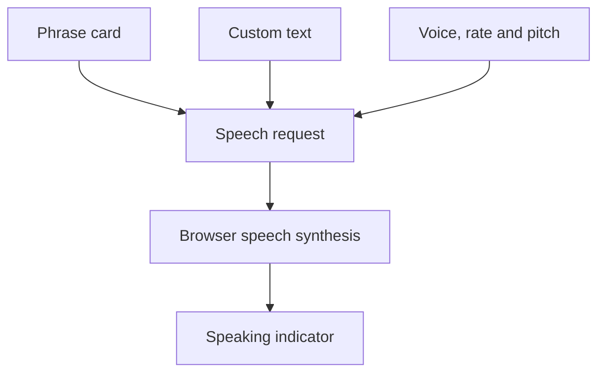

# Sign-to-Speech Tutor

**Tap a phrase or type your own words and hear them spoken by your browser.**


A single-page communication and phrase-practice interface built with native browser speech synthesis. The current implementation uses selectable text and emoji flashcards; it does not recognize signed gestures or translate a sign language.

## Features

- Eight phrase cards: Hello, Thank You, Help, Water, Food, Yes, No, and Please.
- Custom text input with an Enter-to-speak shortcut.
- Voice selection from the voices exposed by the browser.
- Adjustable speaking rate and pitch from 0.5 to 2.
- A visible speaking state and keyboard-operable phrase buttons.

## Run

Use Node.js and npm:

```sh
git clone https://github.com/adeelfalaksher900-creator/Sign-to-Speech-Tutor.git
cd Sign-to-Speech-Tutor
npm run dev
```

Open **http://localhost:3000**. The development script invokes `npx -y serve`, which may download the server package on first use.

Alternatively, serve the repository with Python:

```sh
python3 -m http.server 3000
```

No Gemini key, account, backend, camera, or microphone is used by the application code.

## How it works



| File | Responsibility |
| --- | --- |
| `index.html` | Interface, phrase data, styling, and speech-synthesis logic |
| `package.json` | Static development server command |
| `metadata.json` | Project metadata |

Tailwind CSS and Lucide load from public CDNs. Available voices and their behavior depend on the browser and operating system; a selected voice may use a platform speech service.

## Check changes

No automated test suite is configured. Before proposing a change, check card speech, custom text, voice selection, both sliders, keyboard activation, and the layout at narrow and wide widths. Verify that starting another phrase interrupts the previous utterance.

## Deployment

Publish `index.html` on a static web host. There is no compilation step. The page needs network access for its CDN assets, so offline operation is not guaranteed.

## Contributions and license

Submit focused pull requests with the browser tested and the behavior changed. No license file is currently included.

